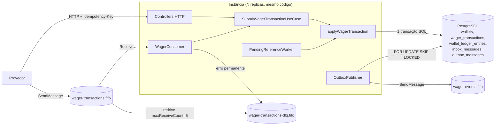
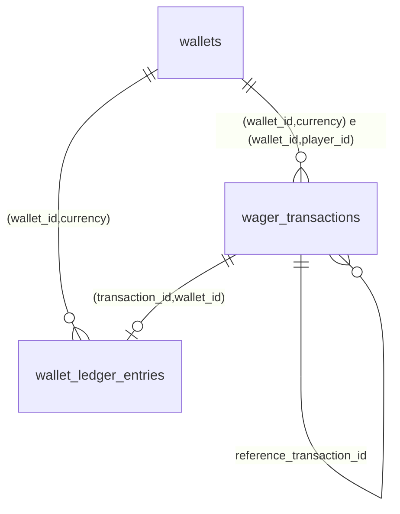
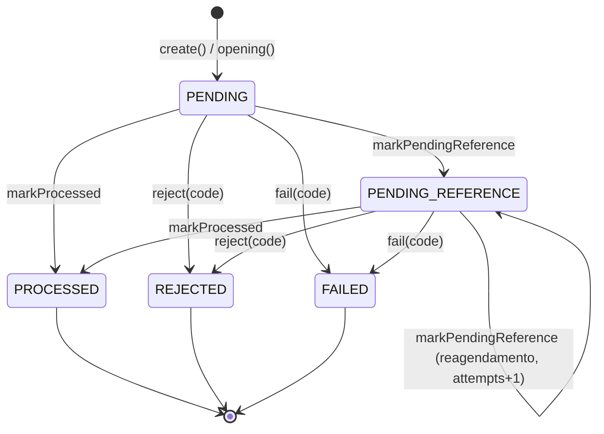
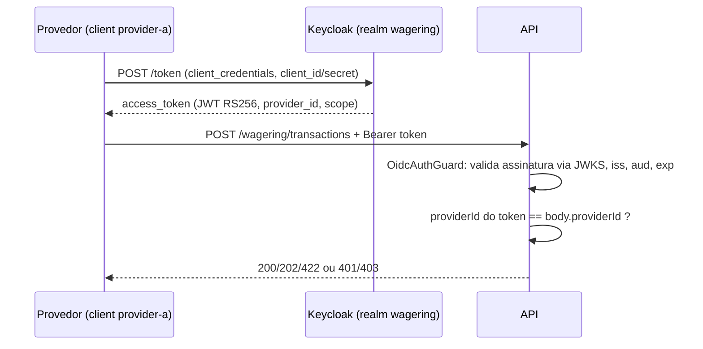

# Arquitetura

Este documento descreve o que o código faz hoje, por que foi feito assim e onde estão os limites. Caminhos são relativos à raiz do repositório. Setup e comandos estão no [README.md](README.md).

Sumário: [a. Visão e fluxo](#a-visão-componentes-e-fluxo-de-uma-transação) · [b. Camadas](#b-camadas-e-regras-de-dependência) · [c. ORM](#c-orm-mikroorm-entityschema-transações-e-money) · [d. Schema](#d-schema-e-invariantes-no-banco) · [e. Concorrência](#e-concorrência) · [f. Idempotência](#f-idempotência) · [g. Estados](#g-máquina-de-estados-da-wagertransaction) · [h. Regras](#h-regras-de-negócio-e-interpretações-adotadas) · [i. failureCodes](#i-taxonomia-de-failurecode) · [j. HTTP](#j-mapa-de-status-http-e-formato-de-erro) · [k. Inbox/outbox](#k-inbox-e-outbox) · [l. Consumidor SQS](#l-consumidor-sqs) · [m. PENDING_REFERENCE](#m-worker-de-pending_reference) · [n. Observabilidade](#n-observabilidade) · [o. Autenticação](#o-autenticação-não-implementada) · [p. Testes](#p-estratégia-de-testes) · [q. Limitações](#q-limitações-conhecidas-e-riscos) · [r. Próximos passos](#r-o-que-eu-faria-com-mais-tempo)

---

## a. Visão, componentes e fluxo de uma transação

Cada instância é o mesmo processo (`src/main.ts`): API HTTP e, com `RUN_WORKERS=1`, três loops em segundo plano (consumidor SQS, publisher da outbox, worker de `PENDING_REFERENCE`). Não há estado compartilhado em memória entre instâncias: toda coordenação passa pelo PostgreSQL.



### Fluxo HTTP até o commit

`POST /wagering/transactions` → `WageringController.create` (`src/infrastructure/http/wagering.controller.ts`) valida corpo e header com zod e chama `SubmitWagerTransactionUseCase.execute` (`src/application/submit-wager-transaction.ts`).

```
execute()
  payloadHash = hashOf(cmd)                 -- Money normalizado para escala 2
  buildTransaction()                        -- validação pura (kind, Money, referência); erro => 400, sem tocar o banco
  uow.run(handle)                           -- MikroOrmUnitOfWork: BEGIN; SET LOCAL lock_timeout = '3s'
    SELECT ... FROM wallets WHERE id = ? FOR UPDATE           (1º lock)
      ausente => REJECTED WALLET_NOT_FOUND (nada persistido)
    findForIdempotency(key, providerId, externalId)           (sem lock, sem identity map)
      existe e bate key + payloadHash => replay (resultado gravado)
      existe e diverge                 => IdempotencyConflictError (409)
    wallet.playerId/currency divergem do payload => REJECTED não persistido
    applyWagerTransaction(...)               (src/application/wager-processor.ts)
      SELECT referência FOR UPDATE           (2º lock, se houver referenceExternalTransactionId)
      evaluateReference => ok | wait | reject
      dupla reversão? => REJECTED REFERENCE_ALREADY_REVERSED
      Wallet.debit/credit => WalletLedgerEntry (validado na factory)
      INSERT wager_transactions
      INSERT wallet_ledger_entries
      UPDATE wallets SET balance, version, updated_at WHERE id = ? AND version = ?
      INSERT outbox_messages (WagerTransactionProcessed, WalletBalanceChanged)
  COMMIT
  métricas e log (só depois do commit: o UoW pode repetir a função)
  HTTP 200 | 202 | 422 conforme o status
```

### Fluxo SQS

```
WagerConsumer.cycle(): ReceiveMessage (até 10, long poll 5 s), agrupa por MessageGroupId
  parse JSON + zod (wagerMessageSchema)       -- falha => DLQ explícita
  execute(msg.data, { inbox })
    uow.run:
      INSERT inbox_messages ... ON CONFLICT (consumer_name, message_id) DO NOTHING RETURNING 1
        já existia => compara payloadHash da mensagem; igual => replay (duplicateMessage), diferente => DLQ
      handle(...)                              -- exatamente o mesmo caminho do HTTP
      UPDATE inbox_messages SET processed_at
    COMMIT
  DeleteMessage                                -- ack só depois do commit
```

### Publicação

```
OutboxPublisher.runOnce() a cada 500 ms
  BEGIN; SET LOCAL lock_timeout = '3s'
  SELECT ... FROM outbox_messages WHERE published_at IS NULL AND next_attempt_at <= now()
    ORDER BY seq LIMIT 25 FOR UPDATE SKIP LOCKED
  para cada linha: SendMessage(wager-events.fifo, MessageGroupId=walletId, MessageDeduplicationId=eventId)
                   ok    => UPDATE published_at
                   falha => UPDATE attempts+1, next_attempt_at = now + backoff
  COMMIT
```

Nenhum evento sai antes do commit da transação financeira: a outbox só fica visível ao publisher depois do commit.

---

## b. Camadas e regras de dependência

| Camada | Pasta | Depende de | Não pode depender de |
|---|---|---|---|
| Domínio | `src/domain` | `decimal.js`, `node:crypto` (hash) | aplicação, infraestrutura, NestJS, MikroORM |
| Aplicação | `src/application` | domínio, portas próprias (`ports.ts`) | NestJS, MikroORM, AWS SDK, pino, prom-client |
| Infraestrutura | `src/infrastructure` | aplicação, domínio, frameworks | - |

- Portas (`src/application/ports.ts`): `WalletRepository`, `TransactionRepository`, `LedgerRepository`, `OutboxRepository`, `InboxRepository`, `UnitOfWork`, `LoggerPort`, `MetricsPort`. Adaptadores: `src/infrastructure/mikro-orm/repositories.ts`, `unit-of-work.ts`, `observability/logger.ts`, `observability/metrics.ts`.
- Os casos de uso são classes simples, sem decorators. `src/app.module.ts` os instancia por `useFactory` injetando `UNIT_OF_WORK`, `METRICS` e `LOGGER`. O consumidor SQS recebe uma instância do mesmo `SubmitWagerTransactionUseCase` (`src/infrastructure/workers/workers.module.ts`).
- Agregados com construtor `private` e factories `create`/`open`/`opening`/`rehydrate`/`receive`/`enqueue`. `rehydrate` não revalida transições.
- O núcleo financeiro (`applyWagerTransaction`) é uma função compartilhada por HTTP, SQS e o worker de `PENDING_REFERENCE`. Ela exige como pré-condição estar dentro de uma transação e ter a wallet travada.
- Concessões: `src/application/id.ts` usa `Bun.randomUUIDv7()` (UUIDv7 ordenável no tempo, bom para B-tree); o consumidor SQS reutiliza `submitSchema` de `infrastructure/http/schemas.ts` para que HTTP e fila validem o mesmo contrato.
- Todo construtor do Nest usa `@Inject(TOKEN)` explícito (`src/infrastructure/tokens.ts`): o código parte do princípio de que o Bun não emite `design:paramtypes`, então a resolução por tipo não é usada.

---

## c. ORM: MikroORM, EntitySchema, transações e Money

### Por que MikroORM

É a opção preferencial do desafio e oferece o que a solução usa: `EntityManager.fork()` por operação, `transactional()`, `LockMode.PESSIMISTIC_WRITE` (gera `FOR UPDATE`), `insert`/`nativeUpdate`/`execute` para SQL explícito, e o `Migrator` com migrations versionadas e reversíveis (`src/infrastructure/mikro-orm/orm.config.ts`: `transactional: true`, `allOrNothing: true`, `snapshot: false`).

O MikroORM é usado como data mapper fino e migrator. Change tracking e flush do Unit of Work não são usados nas escritas (ver abaixo); o domínio não conhece o ORM.

### Por que `EntitySchema`

`src/infrastructure/mikro-orm/schemas.ts` define entidades de persistência (`WalletRow`, `WagerTransactionRow`, `LedgerEntryRow`, `InboxMessageRow`, `OutboxMessageRow`) com `EntitySchema`, sem decorators. Metadata por decorator depende de `emitDecoratorMetadata`/`design:type`, que o transpilador do Bun não garante. Com `EntitySchema` o tipo de cada coluna é declarado explicitamente. Essas classes são linhas, separadas do domínio; a conversão é feita por `src/infrastructure/mikro-orm/mappers.ts`. O schema real (constraints, índices, triggers) vem da migration, não das entidades.

### Estratégia transacional

`MikroOrmUnitOfWork.run` (`src/infrastructure/mikro-orm/unit-of-work.ts`):

1. `orm.em.fork().transactional(...)`: um `EntityManager` novo por execução (`allowGlobalContext: false` impede uso do EM global) e uma transação SQL em `READ COMMITTED` (padrão do Postgres).
2. `SET LOCAL lock_timeout = '3s'` no início da transação.
3. `fn(buildRepos(em))`: os repositórios recebem o EM transacional.
4. Retry limitado em conflitos repetíveis (seção e).

Leituras usam `{ disableIdentityMap: true }` (`FRESH` em `repositories.ts`): cada leitura vai ao banco. Motivos: as escritas são nativas e o identity map não as enxergaria; e uma nova tentativa do UoW nunca pode ver estado em cache da tentativa anterior.

Escritas são nativas (`em.insert`, `em.nativeUpdate`, `em.execute`), na ordem que o código define: transação, depois ledger (FK `ledger_tx_wallet_fk`), depois `UPDATE wallets ... WHERE version = ?`, depois outbox. Não há flush implícito decidindo ordem ou agrupando statements.

O pool tem `min: 1`, `max: DB_POOL_MAX` (20 por padrão).

### Money

| Onde | Representação |
|---|---|
| Contrato (HTTP, SQS, eventos, respostas) | `{ "amount": "25.00", "currency": "BRL" }`, sempre string com escala 2 |
| Domínio (`src/domain/money.ts`) | `Decimal` de um clone isolado do decimal.js (`precision: 40`, `ROUND_HALF_EVEN`) + `currency` |
| Banco | `numeric(20,2)` + `char(3)` em colunas separadas |
| Driver / ORM | string nos dois sentidos (`type: 'string', columnType: 'numeric(20,2)'`) |

- `Money.from` aceita só `^\d{1,18}(\.\d{1,2})?$` (até 18 dígitos inteiros = `numeric(20,2)`), sem sinal, expoente, espaço, `NaN` ou `Infinity`; `amount` que não seja string é rejeitado. Moeda: `^[A-Z]{3}$`.
- `toString()` é `toFixed(2)`. Como a entrada tem no máximo 2 casas e só há soma e subtração, não há arredondamento em operação real.
- `subtract` pode produzir valor negativo; quem decide se é aceitável é a `Wallet` (débito acima do saldo lança `InsufficientFundsError`).
- Operações entre moedas diferentes lançam `CurrencyMismatchError`.
- Na reconciliação, somas são feitas em `NUMERIC` no SQL e voltam como `::text`.
- `number` não aparece em nenhum caminho monetário. Os mappers trimam `char(3)` antes de reidratar.

---

## d. Schema e invariantes no banco

Migration única: `src/infrastructure/mikro-orm/migrations/Migration20261016000001_init.ts` (o `down` remove tabelas e funções em ordem inversa; testado em `schema-constraints.test.ts > migrations reversíveis`).



| Constraint / objeto | Tabela | Garantia | Por que existe |
|---|---|---|---|
| `CHECK (balance >= 0)` | `wallets` | Saldo nunca negativo | Invariante global; última barreira contra bug ou race. |
| `CHECK (version >= 1)`, default 1 | `wallets` | `version` válido | Coerente com "inicia em 1". |
| `CHECK (currency ~ '^[A-Z]{3}$')` | `wallets` | Código de moeda bem formado | Mesmo formato do domínio. |
| `wallets_player_currency_uq UNIQUE (player_id, currency)` | `wallets` | Uma wallet por player + moeda | Requisito 6.2; vira 409 na API. |
| `wallets_id_currency_uq`, `wallets_id_player_uq` | `wallets` | Alvos das FKs compostas | Permitem que as tabelas filhas referenciem (id, moeda) e (id, player). |
| `wt_idempotency_uq UNIQUE (idempotency_key)` | `wager_transactions` | Uma transação por chave | Idempotência persistente, entre instâncias. |
| `wt_provider_external_uq UNIQUE (provider_id, external_transaction_id)` | `wager_transactions` | Um id externo por provedor | Mesma operação com outra chave não gera segundo efeito; é também a chave de resolução de referências. |
| `wt_wallet_currency_fk (wallet_id, currency) → wallets(id, currency)` | `wager_transactions` | Moeda da transação = moeda da wallet | Conflito de moeda impossível de persistir. |
| `wt_wallet_player_fk (wallet_id, player_id) → wallets(id, player_id)` | `wager_transactions` | Player da transação = dono da wallet | Transação não pode ser atribuída à wallet de outro jogador. |
| `wt_id_wallet_uq UNIQUE (id, wallet_id)` | `wager_transactions` | Alvo da FK do ledger | Ledger e transação na mesma wallet. |
| `reference_transaction_id → wager_transactions(id)` | `wager_transactions` | Referência resolvida aponta para transação existente | Integridade da cadeia de reversões. |
| `CHECK kind IN (...)`, `CHECK status IN (...)` | `wager_transactions` | Enums fechados | Valores fora do contrato são impossíveis. |
| `CHECK (amount > 0)` | `wager_transactions` | Valor positivo | Transação de valor zero não tem significado financeiro. |
| `wt_reversal_needs_ref` | `wager_transactions` | REFUND/ROLLBACK têm `reference_external_transaction_id` | Regra 7.1 no schema. |
| `wt_failure_code_iff_failed` | `wager_transactions` | `failure_code` presente se e somente se `REJECTED`/`FAILED` | Toda rejeição carrega código; transação aceita não carrega. |
| `wt_processed_at_iff_processed` | `wager_transactions` | `processed_at` presente se e somente se `PROCESSED` | Estado e carimbo de tempo coerentes. |
| `wt_processed_has_balance` | `wager_transactions` | `PROCESSED` tem `balance_after` | Replay fiel sempre possível. |
| `CHECK (balance_after >= 0)` | `wager_transactions` | Saldo observado não negativo | Coerência com `wallets`. |
| `wt_single_reversal_uq` UNIQUE parcial `(reference_transaction_id) WHERE status = 'PROCESSED' AND kind IN ('REFUND','ROLLBACK')` | `wager_transactions` | No máximo uma reversão processada por referência, de qualquer kind | Garantia final da regra 4 (ver h.1). Reversões `REJECTED` com a mesma referência continuam permitidas. |
| `wt_pending_reference_idx (next_reference_attempt_at) WHERE status = 'PENDING_REFERENCE'` | `wager_transactions` | - | Busca barata das pendências vencidas pelo worker. |
| `wt_wallet_idx (wallet_id, created_at)` | `wager_transactions` | - | Consultas por wallet; nenhuma consulta atual depende dele. |
| Trigger `wager_transactions_guard` (`BEFORE UPDATE OR DELETE`, por linha) | `wager_transactions` | `DELETE` proibido; `UPDATE` proibido se `OLD.status` é terminal; `UPDATE` proibido se mudar id, provider, external id, chave, `payload_hash`, wallet, player, round, game, kind, amount, currency, referência externa ou `created_at` | Terminais são imutáveis e os campos de negócio nunca mudam; só status, referência resolvida, `failure_code`, `balance_after`, tentativas e datas evoluem enquanto não terminal. |
| `CHECK (amount > 0)`, `CHECK (balance_before >= 0)`, `CHECK (balance_after >= 0)` | `wallet_ledger_entries` | Lançamento positivo, saldos não negativos | Invariantes 6.4. |
| `ledger_arithmetic` | `wallet_ledger_entries` | `CREDIT: after = before + amount`; `DEBIT: after = before - amount` | Aritmética do lançamento verificada no banco, além da factory. |
| `ledger_wallet_tx_uq UNIQUE (wallet_id, transaction_id)` | `wallet_ledger_entries` | No máximo um lançamento por transação por wallet | Requisito 6.4; impede débito duplicado mesmo com bug no código. |
| `ledger_wallet_currency_fk (wallet_id, currency)` | `wallet_ledger_entries` | Moeda do lançamento = moeda da wallet | - |
| `ledger_tx_wallet_fk (transaction_id, wallet_id) → wager_transactions(id, wallet_id)` | `wallet_ledger_entries` | Lançamento pertence a uma transação da mesma wallet | - |
| `seq bigserial UNIQUE`, índice `ledger_wallet_seq_idx (wallet_id, seq)` | `wallet_ledger_entries` | Ordem total estável | Base do cursor do ledger e da cadeia `balance_before`/`balance_after`. |
| Triggers `ledger_no_update_delete` (linha) e `ledger_no_truncate` (statement) → `ledger_immutable()` | `wallet_ledger_entries` | Append-only: `UPDATE`, `DELETE` e `TRUNCATE` falham | Restrição 5: ledger nunca sobrescrito nem excluído. |
| `PRIMARY KEY (consumer_name, message_id)` | `inbox_messages` | Uma entrada por mensagem por consumidor | Deduplicação persistente do SQS. |
| `id uuid PRIMARY KEY` (= eventId), `seq bigserial UNIQUE` | `outbox_messages` | Evento único; ordem de inserção | `seq` ordena a publicação. |
| `outbox_pending_idx (next_attempt_at, seq) WHERE published_at IS NULL` | `outbox_messages` | - | Claim barato só sobre pendentes. |

O que o banco não garante sozinho: que `wallets.balance` seja igual à soma do ledger (garantido pelo código na mesma transação e verificado pela reconciliação), e que `version` só mude junto com o saldo (garantido pelo agregado). `wallets` não tem trigger de imutabilidade: o saldo precisa ser atualizável. Não há trigger de `TRUNCATE` em `wager_transactions`.

---

## e. Concorrência

### Estratégia: lock pessimista por wallet

A unidade de concorrência é a linha da wallet. Toda operação que pode mudar saldo começa com `SELECT ... FROM wallets WHERE id = ? FOR UPDATE` (`WalletRepository.findByIdForUpdate`, `LockMode.PESSIMISTIC_WRITE`). Dentro dessa seção crítica a decisão inteira é tomada: busca de idempotência, validação da referência, checagem de dupla reversão, débito/crédito, ledger, `UPDATE` do saldo e outbox. Duas apostas na mesma wallet, em qualquer instância, são serializadas pelo Postgres; wallets diferentes não disputam nada.

### Ordem de lock

Fixa em todo o código: (1) linha da wallet, (2) linha(s) de `wager_transactions`.

- Caso de uso: wallet `FOR UPDATE`, depois a referência `FOR UPDATE` (`findByExternalForUpdate`) dentro de `applyWagerTransaction`.
- Worker de `PENDING_REFERENCE` (`src/infrastructure/workers/pending-reference-worker.ts`): lista candidatas sem lock, e para cada uma abre transação própria e trava wallet, depois a própria transação (`findByIdForUpdate`), depois a referência. Revalida `status` e `next_reference_attempt_at`; se outra instância já tratou, pula.

Como todos adquirem na mesma ordem e a referência pertence (em todo caso válido) à mesma wallet que já está travada, não há ciclo de espera entre o tráfego normal e o worker. Exceção teórica: uma referência que aponta para outra wallet (que termina em `REFERENCE_MISMATCH`) é travada enquanto se segura a wallet do chamador; dois workers com referências cruzadas entre duas wallets podem formar ciclo. O Postgres detecta (`40P01`) e o UoW repete.

### lock_timeout e retry

| Situação | Detecção | Tratamento |
|---|---|---|
| Espera de lock > 3 s | `55P03` (`SET LOCAL lock_timeout = '3s'`) | retry |
| Deadlock | `40P01` | retry |
| Serialization failure | `40001` (não esperado em READ COMMITTED; tratado por segurança) | retry |
| Unique violada por request concorrente (`23505` no insert da transação) | `RetryableConflictError` | retry; na nova tentativa a busca de idempotência encontra a linha |
| Banco indisponível (`ECONNREFUSED`, `ECONNRESET`, `ETIMEDOUT`, `EPIPE`, `57P01`, `57P03`, `53300`, classe `08`, timeout do pool) | `isUnavailable` | `TransientInfrastructureError` imediato, sem retry local |

`MAX_ATTEMPTS = 3`, com espera aleatória de 20 a 80 ms entre tentativas. Esgotadas, vira `TransientInfrastructureError`: HTTP 503 com `Retry-After: 1`; no SQS, retry com backoff de visibilidade. Cada conflito alimenta `wager_lock_conflicts_total{code}` e, se ainda houver tentativa, `wager_retries_total{component="unit_of_work",reason}`.

### Por que não as alternativas

- **Otimista com `version`**: em hot wallet, N requisições leem a mesma versão e N-1 falham e repetem; o trabalho desperdiçado cresce com a contenção e o retry limitado vira 503 sob carga. Com lock pessimista, a fila de espera é do próprio Postgres e nenhuma decisão é refeita.
- **`UPDATE ... SET balance = balance - x WHERE balance >= x`**: resolve o saldo, mas a decisão também envolve idempotência, referência, dupla reversão e `balance_before` do ledger. Seria preciso serializar essas leituras de qualquer forma.
- **Advisory lock**: exige mapear uuid para bigint, não fica amarrado à linha e pode ser esquecido por um caminho de código; o `FOR UPDATE` na linha da wallet é o recurso protegido.
- **Lock global**: proibido (restrição 6) e eliminaria o paralelismo entre wallets.

### `version`

`Wallet.apply` incrementa `version` a cada débito/crédito; abertura nasce em 1 e `LOSS` não muda. `WalletRepository.updateBalance` grava com `WHERE id = ? AND version = ?expected` e lança erro se afetar 0 linhas. Com o lock isso nunca acontece; é defesa contra um caminho futuro que esqueça o `FOR UPDATE`. Esse erro não é classificado como repetível (vira 500 no HTTP e DLQ no SQS).

### Hot wallet e trade-offs

- Throughput por wallet é serial: uma transação por vez segura o lock durante a seção crítica. Como referência (não é teste de carga), na sessão de exemplos do README o caso de uso inteiro, do início ao commit, levou menos de 10 ms em 9 de 16 requisições e menos de 25 ms em todas (`wager_processing_duration_seconds`).
- Requisições na fila de uma wallet quente seguram uma conexão do pool cada uma. Com `DB_POOL_MAX=20`, uma wallet muito quente pode ocupar o pool de uma instância e atrasar outras wallets daquela instância.
- Se a fila de uma wallet passar de 3 s, `lock_timeout` dispara, há até 3 tentativas e depois 503. O teste `phase6 1.` (200 BETs simultâneas na mesma wallet, em 4 processos) termina sem nenhum 5xx; `phase4 hot wallet: 100 BETs de 1.00 em 60.00` dá exatamente 60 processadas e 40 rejeitadas.
- No consumidor SQS, mensagens do mesmo `MessageGroupId` (wallet) são processadas em sequência; grupos distintos em paralelo até `CONSUMER_CONCURRENCY`.

---

## f. Idempotência

### `payloadHash`

`computePayloadHash` (`src/domain/payload-hash.ts`):

1. Subconjunto de negócio: `providerId`, `externalTransactionId`, `playerId`, `walletId`, `roundId`, `gameId`, `kind`, `money: { amount, currency }`, `referenceExternalTransactionId` (omitido se ausente).
2. `money` normalizado antes (`Money.from(cmd.money).toJSON()` em `hashOf`): `"25"`, `"25.0"` e `"25.00"` geram o mesmo hash.
3. JSON canônico (`canonicalJson`): chaves ordenadas recursivamente por comparação de string, sem espaços, propriedades `undefined` removidas, `JSON.stringify` nos valores escalares.
4. SHA-256 em hex (64 caracteres, `char(64)` no banco).

Ficam de fora: o header `Idempotency-Key`, `messageId`, `occurredAt`, `correlationId` e qualquer metadado de transporte. A própria `idempotencyKey` não entra no hash: ela é comparada separadamente.

Exemplo de entrada canônica:
```
{"externalTransactionId":"bet-1","gameId":"fortune-chimp","kind":"BET","money":{"amount":"25.00","currency":"BRL"},"playerId":"...","providerId":"provider-a","roundId":"round-1","walletId":"..."}
```

### Fluxo

```
lock wallet FOR UPDATE
existing = SELECT ... WHERE idempotency_key = ? OR (provider_id = ? AND external_transaction_id = ?)
  (até duas linhas; prioriza a que tem a mesma key)
se existing:
  existing.key == key e existing.payloadHash == hash  => replay
  senão                                              => IdempotencyConflictError (409)
senão: processa e INSERT
```

- **Replay** devolve `toResult(existing, true)`, derivado do estado persistido: `transactionId`, `status`, `failureCode`, `balance` = `balance_after` gravado (saldo após a transação, ou saldo observado na rejeição), `idempotentReplay: true`. O status HTTP é o mesmo da primeira resposta (200 / 202 / 422). Para uma transação que estava `PENDING_REFERENCE` e já foi resolvida, o replay devolve o estado atual (`PROCESSED` ou `REJECTED`).
- **Conflito**: mesma key com payload diferente, ou mesmo `(providerId, externalTransactionId)` com outra key. Não é replay, não grava nada, 409.

### Por que lock → lookup → insert

A busca de idempotência acontece com a wallet já travada. 50 cópias da mesma aposta na mesma wallet fazem fila no lock; a primeira insere e faz commit, as outras 49 encontram a linha e devolvem replay. Sem o lock antes da busca, duas leituras concorrentes poderiam não ver nada e as duas tentariam processar.

### 23505

O lock não cobre a chave quando duas requisições com a mesma key apontam para wallets diferentes (payload divergente). Nesse caso a unique `wt_idempotency_uq` (ou `wt_provider_external_uq`) barra a segunda; `TransactionRepository.insert` converte `23505` em `RetryableConflictError`, o UoW repete a transação inteira e a nova busca encontra a linha: replay ou 409. O mesmo vale para `wt_single_reversal_uq`, que na nova tentativa vira `REFERENCE_ALREADY_REVERSED`.

### SQS

Antes do caso de uso, o inbox deduplica por `(consumer_name='wager-transactions', message_id)` na mesma transação. O hash do inbox (`messageHash`, `src/infrastructure/sqs/wager-consumer.ts`) é SHA-256 do JSON canônico de `{ type, data }` (com `data.idempotencyKey`, sem `messageId`/`occurredAt`/`correlationId`). Mesmo `messageId` com conteúdo diferente é mensagem inconsistente (`InboxPayloadMismatchError`, DLQ). Mesma transação com `messageId` novo passa pelo inbox e cai na idempotência do caso de uso (replay).

Nenhuma garantia depende de memória: a deduplicação do broker (`MessageDeduplicationId`) e a ordem FIFO são otimizações.

---

## g. Máquina de estados da WagerTransaction



- `PENDING` existe só em memória: toda transação é persistida já em `PROCESSED`, `REJECTED` ou `PENDING_REFERENCE`.
- Terminais: `PROCESSED`, `REJECTED`, `FAILED`. Qualquer transição a partir deles lança `InvalidTransactionStateError` (erro de programação), e o trigger `wager_transactions_guard` recusa o `UPDATE` no banco.
- `markPendingReference` incrementa `referenceAttempts` apenas quando já está em `PENDING_REFERENCE`.
- `FAILED` e `INFRASTRUCTURE_FAILURE` existem no modelo, mas nenhum caminho atual os produz: falhas de infraestrutura fazem rollback (nada é persistido) e são devolvidas como transitórias.

---

## h. Regras de negócio e interpretações adotadas

### Efeito por kind

| Kind | Efeito | Ledger | Referência | Eventos |
|---|---|---|---|---|
| `OPENING` (interno) | crédito do saldo inicial | 1 `CREDIT` (0 → inicial) | - | `WagerTransactionProcessed`, `WalletBalanceChanged` |
| `BET` | débito | 1 `DEBIT` | proibida | idem |
| `WIN` | crédito | 1 `CREDIT` | opcional, só `BET` | idem |
| `LOSS` | nenhum | nenhum | opcional, só `BET` | só `WagerTransactionProcessed` |
| `REFUND` | crédito | 1 `CREDIT` | obrigatória, só `BET` | `Processed` + `BalanceChanged` |
| `ROLLBACK` | inverso da referência | 1 lançamento invertido | obrigatória: `BET`, `WIN` ou `REFUND` | `Processed` + `BalanceChanged` |

Rejeição persistida gera `WagerTransactionRejected`; primeira entrada em `PENDING_REFERENCE` gera `WagerTransactionPendingReference`.

### Interpretações

1. **Uma reversão por referência, de qualquer kind.** A regra 4 do desafio fala em "pelo mesmo tipo de operação". Lida ao pé da letra, uma `BET` poderia receber um `REFUND` e um `ROLLBACK`, e os dois creditariam o mesmo valor: crédito duplicado, que é falha eliminatória. Por isso `hasProcessedReversal` e o índice `wt_single_reversal_uq` aceitam no máximo uma reversão `PROCESSED` (REFUND ou ROLLBACK) por `reference_transaction_id`. A segunda vira `REJECTED REFERENCE_ALREADY_REVERSED`. Testado concorrentemente em `phase4 REFUND x ROLLBACK da mesma BET`.
2. **ROLLBACK é o inverso da direção da referência** (`ledgerDirectionFor`): de `BET` credita; de `WIN` ou `REFUND` debita. Não pode referenciar `LOSS`, `ROLLBACK` nem `OPENING` (`INVALID_REFERENCE_KIND`). Um ROLLBACK de REFUND reverte o REFUND, mas a BET original continua contando como revertida (o REFUND segue `PROCESSED`), então um novo REFUND dela é rejeitado.
3. **WIN e LOSS com referência opcional, só para BET.** Se informada, valida provider/player/wallet/rodada/moeda e, se ainda não existe, a transação fica `PENDING_REFERENCE` como um REFUND. O valor não precisa ser igual ao da BET. Várias WIN/LOSS podem referenciar a mesma BET, e WIN não é bloqueada se a BET já foi revertida.
4. **LOSS** é `PROCESSED`, não gera ledger nem muda `version`, e grava em `balance_after` o saldo observado naquele momento (a resposta e o replay mostram esse saldo).
5. **Valores iguais em reversão**: REFUND e ROLLBACK exigem `money` igual ao da referência (`AMOUNT_MISMATCH`); reversão parcial fora de escopo.
6. **Validação da referência**, nesta ordem (`WagerTransaction.evaluateReference`): kind permitido (`INVALID_REFERENCE_KIND`) → mesmo provider, player, wallet e rodada (`REFERENCE_MISMATCH`) → mesma moeda (`CURRENCY_MISMATCH`) → referência `PENDING`/`PENDING_REFERENCE` = aguardar → referência `REJECTED`/`FAILED` = `REFERENCE_NOT_PROCESSED` → valor igual (só REFUND/ROLLBACK). A busca é por `(providerId, referenceExternalTransactionId)`, então o provider já coincide por construção.
7. **Reversão que estouraria o saldo** (ROLLBACK de WIN/REFUND com saldo menor) é `REJECTED REVERSAL_WOULD_OVERDRAW`, distinto de `INSUFFICIENT_FUNDS` (BET), e fica persistida para auditoria.
8. **Rejeições não persistidas**: `WALLET_NOT_FOUND`, `WALLET_PLAYER_MISMATCH` (playerId do payload não é o dono) e `CURRENCY_MISMATCH` entre payload e wallet. As FKs `(wallet_id, currency)` e `(wallet_id, player_id)` impedem gravar uma linha incoerente com a wallet, e não há wallet para referenciar no primeiro caso; relaxar as FKs para auditar essas tentativas enfraqueceria a garantia principal. Consequências: resposta 422 sem `transactionId`, nenhum evento, apenas log `warn` e métrica `wager_transactions_rejected_total{failure_code}`. Um reenvio é reavaliado do zero, mas o resultado é determinístico: o id da wallet é gerado pelo servidor e player/moeda da wallet não mudam. Pela fila, o inbox registra a mensagem; a redelivery do mesmo `messageId` é acked como duplicata.
9. **OPENING é interno**: `providerId='internal'`, `externalTransactionId='opening:<walletId>'`, chave `internal:opening:<walletId>`, `roundId`/`gameId` `opening`. `WagerTransaction.create` recusa o kind, a API responde 400 e a fila manda para a DLQ. Wallet aberta com saldo `0.00` não gera OPENING, ledger nem eventos.
10. **BET não aceita referência** (400); REFUND/ROLLBACK sem referência são 400 (e o CHECK `wt_reversal_needs_ref` repete a regra).
11. **Valor zero** é inválido para qualquer kind (400), inclusive LOSS.
12. **Moeda**: na prática só BRL; o modelo é multi-moeda (wallet única por player + moeda, moeda em toda transação e lançamento) e os conflitos são testados no domínio e no schema. A moeda é validada por formato (`^[A-Z]{3}$`), não contra a lista ISO-4217.
13. **Criação de wallet** não tem chave de idempotência: a unicidade `(player_id, currency)` impede duplicata, mas um retry de um `POST /wallets` cujo commit ocorreu devolve 409 em vez da wallet.
14. **Esgotadas as tentativas de referência**: `REFERENCE_NOT_FOUND` se a referência nunca apareceu; `REFERENCE_NOT_PROCESSED` se ela existe mas continua pendente.

---

## i. Taxonomia de failureCode

Valores em `src/domain/failure-code.ts`, tratados como contrato estável. Uma rejeição persistida "queima" a chave: reenviar o mesmo payload devolve a mesma rejeição (replay) e reenviar a mesma chave com payload corrigido é 409. Corrigir significa enviar uma nova operação com novo `externalTransactionId` e nova chave.

| Código | Quando ocorre | HTTP | Persistida | Provedor deve |
|---|---|---|---|---|
| `INSUFFICIENT_FUNDS` | BET maior que o saldo | 422 | sim | Desistir da operação. Reenviar a mesma é inútil (replay). |
| `REVERSAL_WOULD_OVERDRAW` | ROLLBACK de WIN/REFUND com saldo insuficiente | 422 | sim | Desistir; caso operacional (jogador já gastou o crédito), tratamento manual. |
| `REFERENCE_NOT_FOUND` | Referência não apareceu em `MAX_REFERENCE_ATTEMPTS` | 202 na entrada; depois evento `WagerTransactionRejected` e `GET` | sim | Corrigir: enviar a referência e depois uma nova reversão com novo id. |
| `REFERENCE_NOT_PROCESSED` | Referência `REJECTED`/`FAILED`, ou ainda pendente ao fim das tentativas | 422 (ou assíncrono) | sim | Desistir: não há o que reverter. |
| `REFERENCE_ALREADY_REVERSED` | Referência já tem uma reversão `PROCESSED` | 422 | sim | Desistir: o efeito já foi aplicado. |
| `REFERENCE_MISMATCH` | Referência de outro player, wallet ou rodada | 422 | sim | Corrigir o payload (novo id). |
| `AMOUNT_MISMATCH` | REFUND/ROLLBACK com valor diferente da referência | 422 | sim | Corrigir o payload (novo id). |
| `INVALID_REFERENCE_KIND` | Kind da referência não permitido (ex.: REFUND de WIN, ROLLBACK de LOSS) | 422 | sim | Corrigir o payload (novo id). |
| `CURRENCY_MISMATCH` | Moeda da referência difere (persistida) ou moeda do payload difere da wallet (não persistida) | 422 | depende | Corrigir o payload. |
| `WALLET_NOT_FOUND` | `walletId` inexistente | 422 | não | Corrigir o payload; reenviar a mesma chave é permitido. |
| `WALLET_PLAYER_MISMATCH` | `playerId` não é o dono da wallet | 422 | não | Corrigir o payload. |
| `INFRASTRUCTURE_FAILURE` | Reservado para `FAILED`; não produzido hoje | - | - | - |

Respostas sem `failureCode` que o provedor também precisa distinguir: 400 `INVALID_PAYLOAD` (corrigir), 409 `IDEMPOTENCY_CONFLICT` (não reenviar; investigar a duplicidade de chave), 503 `SERVICE_UNAVAILABLE` (reenviar a mesma requisição com a mesma chave), 202 `PENDING_REFERENCE` (aguardar evento ou consultar `GET`; reenviar devolve o estado atual).

---

## j. Mapa de status HTTP e formato de erro

| Situação | Status | Corpo |
|---|---|---|
| Wallet criada | 201 | `WalletView` |
| Transação `PROCESSED` (primeira vez ou replay) | 200 | `SubmitResult` |
| Transação `PENDING_REFERENCE` (aceite com processamento pendente) | 202 | `SubmitResult` sem `balance` |
| Transação `REJECTED` por regra de negócio (primeira vez ou replay) | 422 | `SubmitResult` com `failureCode` |
| Transação `FAILED` | 500 | mapeado em `STATUS_HTTP`, não alcançável hoje |
| Payload inválido: zod (campo faltando, extra, tipo, uuid), Money inválido, kind inválido/`OPENING`, BET com referência, REFUND sem referência, header ausente, `limit`/cursor inválidos | 400 | `{ "error": "INVALID_PAYLOAD", "message", "details"? }` |
| Recurso inexistente em consultas e reconciliação, rota inexistente | 404 | `{ "error": "NOT_FOUND", "message" }` |
| Conflito de idempotência | 409 | `{ "error": "IDEMPOTENCY_CONFLICT", "message" }` |
| Wallet duplicada (player + moeda) | 409 | `{ "error": "WALLET_ALREADY_EXISTS", "message" }` |
| Falha transitória (banco indisponível, retries de lock esgotados) | 503 + `Retry-After: 1` | `{ "error": "SERVICE_UNAVAILABLE", "message": "Temporary failure, retry" }` |
| `/health/ready` com dependência fora | 503 | `{ "status": "unavailable", "checks": { "postgres", "sqs" } }` |
| Erro não previsto | 500 | `{ "error": "INTERNAL_ERROR", "message": "Internal server error" }` |

`SubmitResult`: `{ transactionId?, status, failureCode?, balance?, idempotentReplay }`. Consultas de transação devolvem o mesmo formato mais `providerId`, `externalTransactionId`, `walletId`, `kind`, `money`, `createdAt` (com `idempotentReplay: false`). O mapeamento fica em um ponto só: `AllExceptionsFilter` (`src/infrastructure/http/filters.ts`) para exceções e `STATUS_HTTP` (`wagering.controller.ts`) para resultados. Rejeições de negócio não são exceções: 422 sempre traz o mesmo `SubmitResult` de um 200. Erros 5xx (exceto 503) são logados como `error`; 503 como `warn`.

---

## k. Inbox e outbox

### Atomicidade

Para uma mensagem SQS, a mesma transação SQL contém: `INSERT inbox_messages`, `INSERT wager_transactions`, `INSERT wallet_ledger_entries`, `UPDATE wallets` e os `INSERT outbox_messages`, mais o `UPDATE inbox_messages SET processed_at`. Ou tudo faz commit, ou nada. Qualquer exceção desfaz também o inbox, então a redelivery processa de novo do zero. Testado em `outbox.test.ts > BET grava eventos na mesma transação; falha depois do insert da outbox não deixa nada`.

### Eventos e envelope

`IntegrationEvent<T>` é abstrata (`src/domain/events.ts`); `WagerTransactionProcessed`, `WagerTransactionRejected`, `WagerTransactionPendingReference` e `WalletBalanceChanged` fixam `eventType` e `version = 1` no tipo e têm factory `from`. Envelope gravado em `outbox_messages.payload` (`jsonb`) e publicado como corpo da mensagem:

```json
{
  "eventId": "UUIDv7 (= outbox_messages.id = MessageDeduplicationId)",
  "eventType": "WagerTransactionProcessed",
  "aggregateId": "walletId (= MessageGroupId)",
  "correlationId": "...",
  "causationId": "messageId do SQS | id da transação (worker) | ausente (HTTP)",
  "occurredAt": "ISO-8601",
  "version": 1,
  "data": { "transactionId", "walletId", "providerId", "externalTransactionId", "kind", "money": {"amount","currency"}, "balanceAfter"? }
}
```

`data` de `WagerTransactionRejected` traz `failureCode`; de `WagerTransactionPendingReference`, `referenceExternalTransactionId`; de `WalletBalanceChanged`: `walletId`, `transactionId`, `direction`, `money`, `balanceBefore`, `balanceAfter`, `walletVersion`. Valores monetários sempre como `MoneyProps`.

### Publisher

`OutboxPublisher` (`src/infrastructure/workers/outbox-publisher.ts`), em todas as instâncias com workers:

- Claim: `published_at IS NULL AND next_attempt_at <= now()`, `ORDER BY seq`, `LIMIT 25`, `FOR UPDATE SKIP LOCKED`. Publishers concorrentes pegam linhas disjuntas, sem lock global e sem esperar uns pelos outros.
- Envio sequencial dentro do lote: `MessageGroupId = aggregateId` (walletId), `MessageDeduplicationId = eventId`.
- Sucesso: `published_at`. Falha de uma linha: `attempts + 1`, `next_attempt_at = now + min(1 s · 2^attempts, 60 s)` (`outboxBackoffMs`), e o lote segue. Não há limite de tentativas nem "dead letter" da outbox.
- Intervalo de 500 ms (`OUTBOX_POLL_MS`) via `PollLoop` (`setTimeout` encadeado, ciclos nunca se sobrepõem).

### Crash depois do commit

1. O caso de uso faz commit: transação, ledger, saldo e outbox estão no banco.
2. O processo morre antes de o publisher ler a linha: ela segue `published_at IS NULL`.
3. Qualquer instância viva (ou a mesma, reiniciada) faz o claim e publica.

Se o processo morrer depois do `SendMessage` e antes do commit da marcação, a transação do publisher é desfeita, o lock cai e a linha é republicada com o mesmo `eventId`. Dentro da janela de deduplicação do SQS FIFO (5 minutos) o broker descarta o reenvio pelo `MessageDeduplicationId`; fora dela o consumidor recebe uma duplicata idêntica e deve deduplicar por `eventId`. Testes: `outbox.test.ts > crash depois do send e antes do commit...` (subclasse que falha em `markPublished`) e `phase6 4.` (publisher morto com `SIGKILL` no meio do trabalho, dois outros assumem; todos os eventos chegam, duplicatas só com corpo idêntico).

### Ordenação

`ORDER BY seq` + `MessageGroupId = walletId` preservam a ordem por wallet dentro de um lote de um publisher. Não é garantia: com vários publishers, lotes consecutivos da mesma wallet podem ser enviados em paralelo por processos diferentes, e uma linha em backoff fica para trás enquanto as seguintes da mesma wallet são publicadas. Consumidores devem usar `walletVersion` (em `WalletBalanceChanged`) e `eventId`, não a ordem de chegada.

### Trade-off: SQS com a transação aberta

O `SendMessage` roda com a transação do claim aberta e as linhas travadas. Vantagem: simples, e o lock garante que ninguém publica a mesma linha ao mesmo tempo. Custo: uma conexão do pool fica ocupada durante as chamadas ao SQS, e uma lentidão do SQS mantém a transação aberta (o `lock_timeout` não limita o tempo de rede). Aceitável com lote de 25. Alternativa: claim por lease (`UPDATE ... SET locked_until = now() + interval, locked_by = ? ... RETURNING` com `SKIP LOCKED`, commit, publicar fora de transação, marcar depois); exige tratar lease expirado.

---

## l. Consumidor SQS

`WagerConsumer` (`src/infrastructure/sqs/wager-consumer.ts`), consumidor `wager-transactions`:

- `ReceiveMessage` com até 10 mensagens, long poll de 5 s, atributos `ApproximateReceiveCount` e `MessageGroupId`.
- Agrupa por `MessageGroupId`; grupos distintos em paralelo (até `CONSUMER_CONCURRENCY=10`), mensagens do mesmo grupo em sequência. Se uma mensagem do grupo cai em retry, as seguintes do lote são devolvidas (`VisibilityTimeout=0`) para não passarem à frente.

### Classificação de erros (`classifyError`)

| Classe | Erros | Ação |
|---|---|---|
| Negócio | `IdempotencyConflictError` | Ack (`DeleteMessage`). Não há inbox (a transação foi desfeita); uma redelivery dá o mesmo conflito. |
| Resultado de negócio | `REJECTED`, `PROCESSED`, `PENDING_REFERENCE` devolvidos pelo caso de uso | Ack após o commit. |
| Duplicata | inbox já tinha o `messageId` com o mesmo hash | Ack; log `duplicate message, acking`. |
| Transitório | `TransientInfrastructureError`, `RetryableConflictError`, códigos de rede | Sem delete. `ChangeMessageVisibility` para `min(2 · 2^(n-1), 60)` s (2, 4, 8, 16, 32, 60), onde n = `ApproximateReceiveCount`. |
| Permanente | JSON inválido, schema zod inválido, erro de domínio (Money inválido, kind `OPENING`, BET com referência), `InboxPayloadMismatchError`, erro desconhecido | DLQ explícita e delete. |

O default é permanente: erro desconhecido não deve girar em retry nem ser engolido.

### Limite de tentativas e DLQ

- Transitórios: a fila tem `maxReceiveCount=5` (`infra/localstack-init.sh`). Na sexta entrega o SQS move a mensagem para `wager-transactions-dlq.fifo` pela redrive policy (5 tentativas, cerca de 1 minuto somando os backoffs 2+4+8+16+32 s).
- Permanentes: `SendMessage` para a DLQ com o corpo original, o mesmo `MessageGroupId`, `MessageDeduplicationId` novo e atributos `reason` (até 1024 caracteres), `errorName`, `receiveCount`, `sqsMessageId`; depois `DeleteMessage`. Se o envio para a DLQ falhar, a mensagem não é deletada e volta após a visibilidade; a redrive policy ainda a leva à DLQ.
- Métricas: `wager_dlq_messages_total` conta os envios explícitos; `wager_dlq_depth` lê `ApproximateNumberOfMessages` da DLQ (cobre também a redrive).

### Ack após o commit

O `DeleteMessage` só acontece depois que `execute` retorna, ou seja, depois do commit. Morrer entre os dois gera redelivery, que encontra o inbox e é acked como duplicata, sem segundo efeito. Gancho de teste: `beforeAck` (opção do construtor, chamado entre o commit e o delete; se lançar, não há delete) e a variável `FAULT_EXIT_BEFORE_ACK=1`, que faz `process.exit(137)` exatamente nesse ponto. Testes: `sqs-consumer.test.ts > falha entre commit e ack...` e `phase6 3.` (processo real morto, outro processo recebe a redelivery como duplicata, um único débito).

### Shutdown gracioso

`src/main.ts` trata `SIGTERM`/`SIGINT` com `app.close()` e `process.exit(0)`. `WorkersModule.beforeApplicationShutdown` roda antes de o ORM e o cliente SQS fecharem:

1. `consumer.stop()`: para de fazer polling; mensagens recebidas e ainda não iniciadas são devolvidas na hora (`VisibilityTimeout=0`); espera os handlers em andamento até `CONSUMER_SHUTDOWN_TIMEOUT_MS` (20 s). Se o prazo estourar, devolve a visibilidade das mensagens em voo; se o handler ainda fizer commit depois, a redelivery cai no inbox.
2. Publisher e worker de `PENDING_REFERENCE` param e esperam o ciclo atual.
3. ORM e cliente SQS fecham (`onApplicationShutdown`).

Um segundo sinal durante o close encerra o processo imediatamente. `phase6 7.` mede: `SIGTERM` com 60 mensagens de um único grupo em voo, saída com código 0 em dezenas de milissegundos, nenhuma mensagem presa como invisível, total de débitos igual a 60 depois que outra instância assume.

---

## m. Worker de PENDING_REFERENCE

`PendingReferenceWorker` (`src/infrastructure/workers/pending-reference-worker.ts`), intervalo `PENDING_REFERENCE_POLL_MS=1000`, lote de 50.

1. Lista candidatas sem lock: `status = 'PENDING_REFERENCE' AND next_reference_attempt_at <= now`, ordenadas por vencimento (índice parcial `wt_pending_reference_idx`).
2. Para cada uma, transação própria: wallet `FOR UPDATE`, transação `FOR UPDATE`, revalida status e vencimento (outra instância pode ter tratado), e chama `applyWagerTransaction(..., 'update')`, o mesmo núcleo do caso de uso.
3. Desfechos: referência encontrada e válida → `PROCESSED` (+ eventos); regra violada → `REJECTED`; ainda ausente → reagenda; tentativas esgotadas → `REJECTED` com evento `WagerTransactionRejected`.
4. Falha em uma candidata é logada e não impede as demais.

### Backoff e limite

`referenceBackoffMs(n) = min(5 s · 2^n, 300 s)` e `MAX_REFERENCE_ATTEMPTS = 8` (`src/domain/wager-transaction.ts`). Linha do tempo a partir da chegada, sem contar a latência do poll:

| Avaliação | Quando (acumulado) | `reference_attempts` depois | Próxima espera |
|---|---|---|---|
| Entrada (HTTP/SQS) | 0 s | 0 | 5 s |
| Worker 1 | 5 s | 1 | 10 s |
| Worker 2 | 15 s | 2 | 20 s |
| Worker 3 | 35 s | 3 | 40 s |
| Worker 4 | 75 s | 4 | 80 s |
| Worker 5 | 155 s | 5 | 160 s |
| Worker 6 | 315 s | 6 | 300 s (teto) |
| Worker 7 | 615 s | 7 | 300 s (teto) |
| Worker 8 | 915 s (~15 min) | - | rejeita |

Justificativa: referências fora de ordem acontecem por reordenação entre canais (HTTP e fila) ou por retry do provedor, normalmente em segundos. As primeiras avaliações são rápidas para resolver esses casos com pouca latência; o teto de 5 minutos evita trabalho inútil; e o total de cerca de 15 minutos cobre com folga o ciclo de redelivery da própria fila (5 entregas com backoff de até 1 minuto e visibilidade de 30 s) e retries do provedor, sem deixar uma reversão em aberto indefinidamente. Depois disso o provedor recebe uma resposta definitiva (`REFERENCE_NOT_FOUND`, ou `REFERENCE_NOT_PROCESSED` se a referência existe mas ficou pendente) e pode agir. É um valor de projeto, ajustável em uma constante.

---

## n. Observabilidade

### Logs

pino em JSON para stdout, síncrono (`src/infrastructure/observability/logger.ts`). Campos base: `level`, `time` (ISO), `service: "wager-processor"`, `pid`, `msg`.

| Origem | Campos |
|---|---|
| Acesso HTTP (uma linha por requisição; `debug` para `/health` e `/metrics`) | `correlationId`, `method`, `route` (padrão da rota, ex.: `/wallets/:walletId`), `status`, `durationMs` |
| Caso de uso | `correlationId`, `messageId` (SQS), `walletId`, `providerId`, `kind`, `transactionId`, `status`, `failureCode` |
| Consumidor (`component: "WagerConsumer"`) | `sqsMessageId`, `receiveCount`, `messageId`, `causationId`, `correlationId`, `walletId`, `providerId`, `transactionId`, `status`, `failureCode`, `errorName`, `retryInSeconds` |
| Publisher / worker | `eventId`, `eventType`, `attempts` / `transactionId`, `walletId`, `providerId`, `outcome` |
| UoW | `reason`, `code`, `attempt`, `exhausted` |

- `correlationId`: header `X-Correlation-Id` se casar com `^[A-Za-z0-9._:-]{1,128}$`, senão UUIDv7 novo; devolvido no header da resposta. No SQS vem de `correlationId` do envelope ou é gerado. Vai também para os eventos da outbox.
- Logs de negócio levam só identificadores e códigos. Como rede de segurança, `redact` censura `money`, `amount`, `balance`, `balanceBefore`, `balanceAfter`, `initialBalance`, `storedBalance`, `calculatedBalance`, `payload`, `body`, `authorization` no topo e um nível abaixo.
- `errFields`: erros com SQLSTATE expõem só nome e código (a mensagem do driver traz SQL com parâmetros).

### Métricas (`GET /metrics`, prom-client, registry por instância)

| Nome | Tipo | Labels | Significado |
|---|---|---|---|
| `wager_transactions_total` | counter | `status`, `kind` | Resultados gravados (primeira execução; replays não contam). Inclui desfechos do worker. |
| `wager_transactions_rejected_total` | counter | `failure_code` | Rejeições por código, persistidas ou não. |
| `wager_duplicates_total` | counter | `source` (`http`, `sqs`) | Replays de idempotência e duplicatas de inbox. |
| `wager_idempotency_conflicts_total` | counter | - | Mesma key/externalId com payload diferente. |
| `wager_retries_total` | counter | `component` (`unit_of_work`, `sqs_consumer`, `outbox_publisher`), `reason` | Retries efetivamente agendados. |
| `wager_lock_conflicts_total` | counter | `code` (`40P01`, `40001`, `55P03`) | Conflitos de lock no Postgres, inclusive o que esgota as tentativas. |
| `wager_dlq_messages_total` | counter | - | Mensagens enviadas à DLQ pelo consumidor. |
| `wager_dlq_depth` | gauge | - | `ApproximateNumberOfMessages` da DLQ, lido no scrape. |
| `wager_outbox_published_total` | counter | - | Eventos publicados (contados após o commit da marcação). |
| `wager_outbox_publish_failures_total` | counter | - | Falhas de envio da outbox. |
| `wager_outbox_pending` | gauge | - | Linhas da outbox não publicadas, lido no scrape. |
| `wager_outbox_lag_seconds` | gauge | - | Idade do evento pendente mais antigo. |
| `wager_processing_duration_seconds` | histogram | `source` | Duração do caso de uso, do início ao commit (buckets 5 ms a 5 s). |
| `wager_pending_reference_total` | counter | `outcome` (`resolved`, `rejected`, `rescheduled`) | Reprocessamentos do worker. |
| `wager_reconciliation_divergences_total` | counter | - | Reconciliações com divergência. |

Mais as métricas padrão de processo do prom-client. Os gauges lidos no scrape usam timeout de 1,5 s e falham em silêncio, mantendo o último valor: são best-effort, e `/metrics` nunca falha por causa deles. Métricas e logs do caso de uso só são emitidos depois do commit, para não contar em dobro quando o UoW repete a transação.

### Health

- `GET /health/live`: processo vivo, sem dependências.
- `GET /health/ready`: `select 1` no Postgres e `GetQueueUrl` + `GetQueueAttributes` na fila de transações (timeout de 2 s no SQS). 503 com `checks` se algum estiver fora. Os testes de cluster usam esse endpoint para saber quando um processo está pronto.

### Reconciliação

`POST /wallets/:walletId/reconciliation` (`src/application/reconcile-wallet.ts`). Um único `SELECT` (um snapshot, sem `FOR UPDATE`, sem bloquear tráfego) lê o saldo da wallet, a soma de créditos e débitos em `NUMERIC`, o número de lançamentos e as quebras de cadeia (`balance_before` diferente do `balance_after` anterior, via `lag()` ordenado por `seq`, partindo de 0). `consistent = difference == 0 && sem quebras`. Divergência não é corrigida: gera log `error` (`wallet reconciliation divergence`), incrementa `wager_reconciliation_divergences_total` e é devolvida com `consistent: false` (e `chainBroken: true` se for o caso), com status 200, porque a divergência é o resultado da auditoria, não falha da requisição.

---

## o. Autenticação (não implementada)

### Decisão

A seção 2 do desafio não pontua autenticação e recomenda não deixá-la competir com correção financeira, concorrência e idempotência. Não foi implementada. Os endpoints estão abertos.

### Pontos de extensão no código

- `NoopAuthGuard` (`src/infrastructure/http/auth.ts`) registrado como `APP_GUARD` global em `src/app.module.ts`; hoje devolve `true`.
- `ProviderIdentityPort` (`resolve(request): string | undefined`) e `NoopProviderIdentity` no mesmo arquivo, com o token `PROVIDER_IDENTITY`. A porta está definida mas ainda não está registrada no container nem consumida pelo guard.

### Desenho com Keycloak (OIDC)



- Keycloak como serviço no `docker-compose.yml`, realm `wagering` importado de um JSON versionado.
- Um client confidencial por provedor, fluxo `client_credentials` (máquina para máquina, sem usuário). Um protocol mapper "hardcoded claim" adiciona `provider_id` ao token (ou se usa o `azp`/`client_id` como providerId).
- Escopos: `wagering:write` (submeter), `wagering:read` (consultas de transação), `wallets:write` e `wallets:read`, `reconciliation:run` (operadores internos). Audience da API (`wagering-api`).
- `OidcAuthGuard` substitui o `NoopAuthGuard` no `APP_GUARD`: extrai o Bearer, valida com JWKS remoto em cache (biblioteca `jose`, `createRemoteJWKSet`), confere `iss`, `aud`, `exp`/`nbf` e escopos por rota (metadata via decorator). Rotas marcadas como públicas (`/health/*`, `/metrics`) são isentas; `/metrics` deveria ficar restrito à rede interna.
- `KeycloakProviderIdentity implements ProviderIdentityPort` lê o claim. O guard compara com `body.providerId` em `POST /wagering/transactions` e com `:providerId` em `GET /providers/:providerId/...`; divergência = 403. Para `GET /wagering/transactions/:id`, a checagem é feita depois da leitura (o `providerId` da transação deve ser o do token).
- 401 para token ausente/inválido, 403 para escopo ou provider divergente. Esses códigos entram no filtro como já fazem 400/404.
- Mensagens SQS são canal interno confiável: a autorização fica na política IAM da fila (quem pode `SendMessage`). A identidade contida na mensagem continua sujeita às validações de domínio (referência resolvida por `(providerId, externalId)`, player e wallet conferidos).

---

## p. Estratégia de testes

| Camada | Arquivos | Real | Testes |
|---|---|---|---|
| Unidade | `test/unit/*` | domínio puro; reconciliação com snapshot simulado | 82 |
| Integração | `test/integration/*` | Postgres 16 e LocalStack reais; app Nest real (`createApp`, `listen(0)`); filas temporárias por teste | 77 |
| Concorrência | `test/concurrency/phase4.test.ts` | caso de uso e HTTP com `Promise.all` (paralelismo real no banco) | 37 |
| Concorrência multi-processo | `test/concurrency/phase6.test.ts` | processos `bun src/main.ts` via `Bun.spawn` (`test/support/cluster.ts`), portas livres, `SIGKILL`/`SIGTERM` reais | 7 |

- Nenhum teste substitui o Postgres ou o SQS por mock. Falhas são injetadas em pontos estreitos, com o resto real: um `UnitOfWork` que lança `TransientInfrastructureError` (`sqs-consumer.test.ts > erro transitório...`, o único stub de infraestrutura), um erro `40P01` lançado dentro de uma transação real (`observability.test.ts`), uma subclasse do publisher que falha em `markPublished`, uma fila inexistente para simular falha de publicação, um `UnitOfWork` que lança depois de gravar tudo (atomicidade), o gancho `beforeAck` e `FAULT_EXIT_BEFORE_ACK`.
- Determinismo: o worker de `PENDING_REFERENCE` e o publisher aceitam `now` injetado, então os testes avançam o relógio sem dormir; esperas usam `eventually` com prazo, não `sleep` cego.
- Isolamento: cada teste cria wallets e UUIDs novos; os cenários SQS criam filas FIFO próprias (principal, DLQ com redrive e eventos) e as apagam; `withCluster` mata todos os processos no `finally` e imprime os logs em caso de falha.
- Invariante final em todos os cenários de concorrência: `assertWalletConsistent` (`test/support/invariants.ts`).
- O mapa requisito → teste está no README.

---

## q. Limitações conhecidas e riscos

- **Publisher com transação aberta durante o SQS**: segura conexão e locks pelo tempo das chamadas de rede; um SQS lento prende a transação (seção k).
- **Ordenação de eventos não garantida entre lotes/publishers** nem quando uma linha entra em backoff. Ordem por wallet é melhor esforço; consumidores precisam de `walletVersion` e dedup por `eventId`.
- **Duplicatas de evento após 5 minutos**: fora da janela de dedup do FIFO, uma republicação chega ao consumidor.
- **Rejeições não persistidas** (`WALLET_NOT_FOUND`, `WALLET_PLAYER_MISMATCH`, moeda do payload) não ficam em `wager_transactions`; a trilha é só log e métrica.
- **`FAILED` não é produzido**: não há caminho que marque uma transação como falha permanente de infraestrutura; tudo é rollback + retry.
- **Outbox sem limite de tentativas**: um evento que nunca publica fica em backoff de 60 s para sempre (visível em `wager_outbox_lag_seconds`).
- **Gauges best-effort**: `wager_outbox_pending`, `wager_outbox_lag_seconds` e `wager_dlq_depth` mantêm o último valor se a sonda falhar.
- **Pool de conexões vs. instâncias**: `DB_POOL_MAX=20` por instância e `max_connections=200` no Postgres do compose. Com muitas réplicas é preciso ajustar ou usar PgBouncer (em modo transação, `SET LOCAL` continua válido). Hot wallet consome uma conexão por requisição em espera.
- **Wallets quentes serializam**: throughput por wallet é limitado pela seção crítica; fila maior que 3 s vira retry e depois 503.
- **Single-region, single-database**: o Postgres é o ponto de coordenação e de falha. Sem réplicas de leitura nem failover configurado.
- **Sem particionamento** de ledger, transações ou outbox; crescimento contínuo.
- **Sem retenção**: `inbox_messages` e `outbox_messages` publicadas nunca são limpas.
- **Sem rate limiting, sem TLS e sem autenticação** (seção o). `/metrics` aberto.
- **Criação de wallet não idempotente por chave** (retry pós-commit recebe 409).
- **Cross-wallet reference**: o lock de uma referência de outra wallet foge da ordem wallet → transação da mesma wallet; deadlock teórico tratado por retry (seção e).
- **LocalStack não é SQS**: janela de deduplicação, entrega por grupo FIFO, `ApproximateReceiveCount` e tempo de redrive são aproximações. Os testes provam o comportamento do código, não do broker real.
- **Logs síncronos**: o destino do pino é síncrono (para que a linha saia antes de um `process.exit` nos testes de crash); sob carga alta, escrita em stdout bloqueia o event loop.
- **Reconciliação loga a diferença**: o log de divergência inclui o campo `difference` (valor monetário), que não está na lista de `redact`.
- **Imagem Docker**: sem `.dockerignore`, `COPY . .` leva `node_modules` e `.env` do host. O container não roda migrations.
- **Testes e dev compartilham o banco**: dados de teste se acumulam e `outbox.test.ts` marca como publicada toda a outbox pendente.
- **Hash do inbox não normaliza Money**: o mesmo `messageId` reenviado com `"25"` em vez de `"25.00"` é tratado como mensagem inconsistente (DLQ), embora a transação seja a mesma.

---

## r. O que eu faria com mais tempo

1. **Publisher com claim por lease** (`locked_until`, `locked_by`), publicação fora da transação e marcação em lote; ou outbox via CDC (Debezium lendo o WAL) para tirar o polling do banco.
2. **Retenção e particionamento**: particionar `wallet_ledger_entries`, `wager_transactions` e `outbox_messages` por tempo; job de limpeza do inbox (janela maior que a de redelivery) e da outbox publicada.
3. **Teste de carga `bun run test:load`**: N instâncias, mistura de wallets frias e quentes, p50/p95/p99, taxa de 503, `wager_lock_conflicts_total`, `wager_outbox_lag_seconds`; documentar o ponto em que o pool satura.
4. **Autenticação real** conforme a seção o, com Keycloak no compose e testes de 401/403.
5. **OpenTelemetry**: traces do HTTP/SQS até o commit e a publicação, com `correlationId`/`causationId` como atributos; dashboard.
6. **Rate limiting** por provedor (token bucket no gateway ou no Postgres/Redis).
7. **Double-entry**: contas contrapartida por provedor e por tipo de operação, com soma zero por transação verificada no banco.
8. **Snapshots de saldo** para acelerar reconciliação de wallets com ledger longo, e reconciliação periódica em background.
9. **Auditoria das rejeições não persistidas** numa tabela própria, sem FKs para a wallet.
10. **Limite e dead letter da outbox**, com alerta.
11. **Chaos tests**: derrubar Postgres e LocalStack durante a carga (toxiproxy), `pg_terminate_backend` em transações em andamento.
12. **ADRs** curtos para as decisões das seções c, e, f, h.1 e k.
